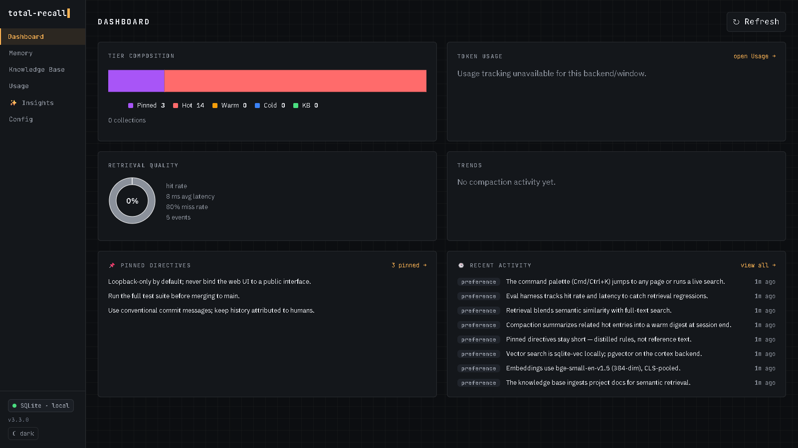

# Web UI

total-recall ships a built-in local web UI — a third surface alongside the MCP server (AI assistant integration) and the CLI (`total-recall status`, `total-recall eval`, etc.). It is a React SPA served directly from the single NativeAOT binary, no separate install or Node required.

**Design.** The UI has a developer-native *Terminal / Archive* identity: a monospace-forward type system (self-hosted **JetBrains Mono** + **IBM Plex Sans** — bundled into the binary, no CDN, fully offline), a fixed **left navigation rail**, a faint ruled-grid backdrop, and an amber phosphor accent. It ships **dark and light themes** with a toggle — your choice persists, and on first visit it follows your OS preference. A **⌘K / Ctrl-K command palette** jumps to any page and runs live search across memories and the knowledge base, so the whole UI is reachable from the keyboard.



```bash
total-recall ui                  # serve on http://localhost:5577 and open the browser
total-recall ui --port 5600      # custom port
total-recall ui --no-open        # suppress auto-open (e.g. remote / headless)
total-recall ui --host 0.0.0.0   # bind all interfaces (warns about exposure)
total-recall ui --token <tok>    # supply a fixed token instead of a per-launch random one
total-recall ui --smoke          # CI mode: start, GET /api/health, exit 0/1
```

The server binds **loopback only** (`localhost`) by default. Every launch generates a fresh ephemeral bearer token that is injected directly into the served HTML, so opening the URL in a browser is sufficient — no copy-paste of credentials. A Host-header allowlist mitigates DNS-rebinding.

**Seven sections** are available in the left navigation rail:

| Section | What it shows |
|---|---|
| Dashboard | Tier composition, retrieval quality, token usage, recent activity, trend sparklines |
| Memory | Browse, search, filter, promote/demote/pin/delete individual entries |
| Knowledge Base | List collections, search, ingest files/directories, refresh or remove collections |
| Usage | Token expenditure by host, project, model, and time window; per-session breakdown |
| ✨ Insights | Memory-health score with an expandable breakdown, plus actionable cards computed server-side from your local store (no LLM): merge near-duplicate memories, promote high-use entries to pinned, surface retrieval gaps, and tune the similarity threshold from a recall curve |
| Eval | Run the retrieval benchmark, review hit/miss/MRR with per-tier & per-content-type breakdowns and top misses, grow the benchmark from real retrieval misses, and compare config snapshots |
| Config | Edit a safe subset of tuning knobs (validated, persisted via `config_set`); storage & embedding shown read-only |

**Cost figures** in the Usage section are **client-side estimates** derived from a bundled model pricing table. They are not billed amounts.

The SPA build is **opt-in** (`-p:BuildSpa=true` triggers `npm ci && npm run build` in `ClientApp/` and embeds the Vite output in the assembly). Default `dotnet build` and all tests are Node-free — the binary falls back to a placeholder page when built without the SPA. Release builds always include the SPA.
